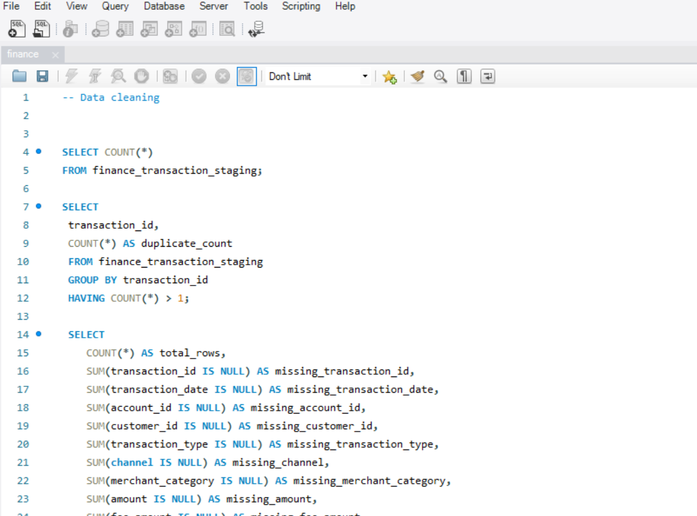
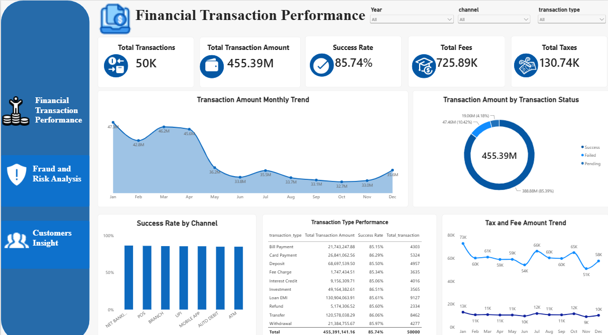
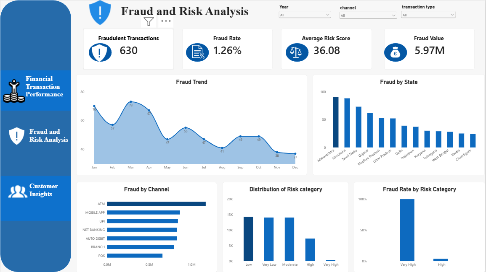
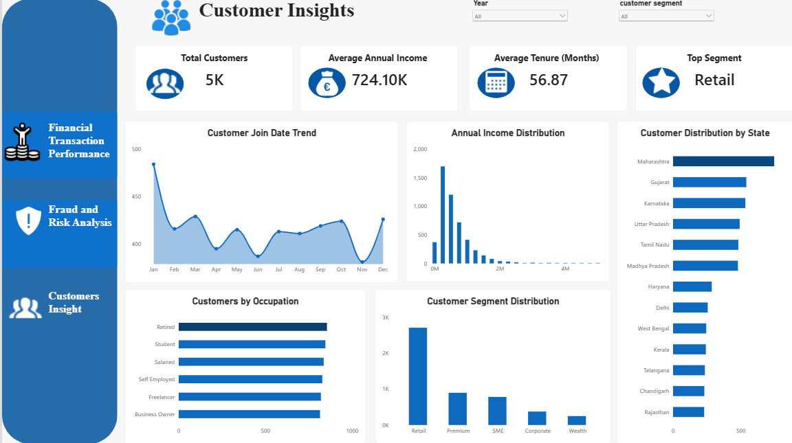

# Financial Transactions, Fraud and Customer Analysis

A data analytics project on 50,000 financial transactions and 5,000 customers. I cleaned the data in MySQL and presented it in a three-page Power BI dashboard covering transaction performance, fraud and risk, and customer insights.

---

## Project summary

I cleaned and analysed a financial dataset of 50,000 transactions worth ₹455.39M, plus a customer table of 5,000 customers. The cleaning was done in SQL (MySQL), and the results are in a Power BI dashboard with three pages: Financial Transaction Performance, Fraud and Risk Analysis, and Customer Insights.

**Headline findings:**

- 85.74% of transactions succeed, and the rate is almost the same (about 85% to 86%) on every channel and transaction type.
- 630 transactions (1.26%) were fraudulent, worth ₹5.97M. Every transaction in the Very High risk category was fraudulent.
- Retail is the largest customer segment, at about 54% of customers, and most customers sit in the lowest income bands.

---

## Introduction

The project follows a typical analyst workflow: assess and clean the raw data in SQL, then analyse it and present it in a dashboard that a business team could use.

---

## Business questions

1. **Transaction performance:** how much is being processed, how many transactions succeed, and which transaction types and channels matter most?
2. **Fraud and risk:** how much fraud is there, where is it, and how well does the risk classification line up with it?
3. **Customers:** who are the customers, in terms of segment, occupation, income, location and tenure?

---

## Data overview

**Currency:** Indian rupees (₹). **Period:** 2023 to 2026.

| Table | Rows | Columns |
|---|---|---|
| Transactions | 50,000 | transaction_id, transaction_date, account_id, customer_id, transaction_type, channel, merchant_category, amount, fee_amount, tax_amount, currency, transaction_status, is_fraud, risk_score, reference_no |
| Customers | 5,000 | customer_id, first_name, second_name, gender, city, state, occupation, customer_segment, date_of_birth, join_date, plus annual income and tenure, which are analysed in the dashboard |

---

## Data cleaning

I did all the cleaning in SQL (MySQL). I worked on staging copies of both tables and created the cleaned tables at the end. The full scripts are in the `sql` folder.

### Finance table

| Step | What I did |
|---|---|
| Row count and duplicates | Counted the rows and checked `transaction_id` for duplicates with `GROUP BY` and `HAVING COUNT(*) > 1` |
| Missing values | Counted NULLs in every one of the 15 columns |
| Zero values | Checked amount, fee, tax and risk score for zeros |
| Date type | Converted `transaction_date` to the DATE type |
| Category check | Listed the distinct values of transaction type, channel, merchant category, currency, status and the fraud flag to look for inconsistencies |
| Standardising text | Applied `UPPER(TRIM())` to `channel` and `merchant_category` |
| Typo fix | Corrected "M@BILE APP" to "MOBILE APP" in `channel` |
| Negative values | Checked amount, fee, tax and risk score for negatives |
| Outliers | Used the IQR method on `amount` (bounds of about -₹10,910 and ₹24,508) and on `fee_amount` (bounds of -₹21.96 and ₹36.60). I reviewed the high outliers by transaction type and status and looked at the 20 largest. The script deletes no rows |
| Currency | Standardised "inr" to "INR" |
| Cleaned table | Saved the result as `finance_transaction_cleaned` |



### Customers table

| Step | What I did |
|---|---|
| Duplicates | Checked `customer_id` for duplicates |
| Missing values | Checked for missing customer IDs and names |
| Category check | Listed the distinct values of gender, city, state, occupation and customer segment |
| Dates | Tested converting `date_of_birth` and `join_date` from dd-mm-yyyy text to dates with `STR_TO_DATE` |
| Cleaned table | Saved the result as `customer_cleaned` |


---

## Key insights


### 1. Financial transaction performance

1. **Volume and value.** The dataset holds 50,000 transactions worth ₹455.39M, an average of about ₹9,108 per transaction.
2. **Success and failure.** The success rate is 85.74% by count. By value, successful transactions are ₹388.88M (85.39%), failed ones ₹47.46M (10.42%) and pending ones ₹19.06M (4.18%). Together, failed and pending transactions represent ₹66.52M, or 14.60% of the value.
3. **No weak channel.** Success rates sit at about 85% to 86% on every channel. By transaction type they run from 85.06% (Interest Credit) to 86.51% (Investment), a gap of under 1.5 percentage points. No single channel or type clearly outperforms the others.
4. **Three types carry most of the value.** Loan EMI (₹130.90M, 28.7%), Transfer (₹120.58M, 26.5%) and Deposit (₹68.70M, 15.1%) together make up about 70% of the value. Loan EMI is also the most frequent type, with 9,127 transactions (18.3%).
5. **No steady monthly pattern.** Activity did not follow one annual pattern. May was the busiest month in 2023 and 2024, and July in 2025.
6. **Fees and taxes move together.** Total fees are ₹725.89K and total taxes ₹130.74K, so taxes are 18.0% of fees. Fees come to about 0.16% of the value processed.

### 2. Fraud and risk

1. **Overall fraud.** 630 of the 50,000 transactions were fraudulent, a rate of 1.26%. They were worth ₹5.97M, or 1.31% of total value. The average fraudulent transaction was about ₹9,480, around 4% above the overall average of ₹9,108.
2. **Month by month.** Across all years combined, monthly fraud counts range from 37 (December) to 73 (March). No single month had the most fraud in every year.
3. **By state.** Maharashtra had the most fraud overall, with about 90 cases (roughly 14% of the total). The leading state changed by year: Karnataka in 2023, Maharashtra in 2024 and Tamil Nadu in 2025. The top three states account for about 40% of fraud cases.
4. **By channel.** ATM had the highest fraud value overall, at about ₹1.2M, roughly 20% of all fraud value. POS had the lowest, at about ₹0.66M. Net Banking led in 2024 before ATM took the top spot again in 2025 and 2026.
5. **Risk distribution.** Low, Very Low and Moderate risk each hold about 14,000 transactions, together about 85% of the total. High risk holds about 7,300 (about 15%), and Very High fewer than 500 (under 1%). The average risk score is 36.08.
6. **Fraud rate by risk category.** All Very High risk transactions were fraudulent (100%), against about 4% in the High category. This is a very strong link, and it is worth checking how the risk category was built (see Limitations).

### 3. Customers

1. **Customer base.** There are 5,000 customers with an average annual income of ₹724.10K and an average tenure of 56.87 months (about 4.7 years).
2. **Segments.** Retail is the largest, at about 2,700 customers (roughly 54%), followed by Premium (about 900), SME (about 780), Corporate (about 380) and Wealth (about 250, roughly 5%).
3. **Joining pattern.** January had the most new customers, about 485 (roughly 10% of all customers). Other months ran at about 380 to 430.
4. **Occupation.** The six occupation groups are almost evenly sized, at about 800 to 850 customers each (around 16% to 17%). Retired is the largest and Business Owner the smallest, but the gap is small.
5. **Income.** Incomes are right-skewed. Most customers are in the lowest bands, with the tallest bars near ₹250K and ₹500K, and the numbers fall steadily as income rises. Only a few customers earn between about ₹4M and ₹5M, and they pull the ₹724.10K average up.
6. **Location.** Maharashtra has the most customers, about 750 (roughly 15%), followed by Gujarat and Karnataka at about 540 each.

---

## Dashboard

I built a three-page Power BI dashboard with year, channel, transaction type and customer segment filters.

**Financial Transaction Performance:** total transactions, total amount, success rate, fees and taxes, the monthly amount trend, amount by status, success rate by channel and a transaction type table.



**Fraud and Risk Analysis:** fraudulent transactions, fraud rate, average risk score, fraud value, the fraud trend, fraud by state and channel, the risk category distribution and the fraud rate by risk category.



**Customer Insights:** total customers, average income, average tenure, top segment, the join date trend, income distribution, and customers by occupation, segment and state.



---

## Recommendations

### Financial transactions

1. **Focus on reducing failed and pending transactions.** Together they are ₹66.52M, or 14.60% of value. Because the success rate is almost identical across channels and types, the cause is more likely to be shared across the system than tied to one channel. That is a hypothesis to test by looking at failure reasons.
2. **Watch Loan EMI, Transfer and Deposit most closely.** They carry about 70% of the value, so failures there cost the most.
3. **Track fees as the driver of tax.** Taxes are 18.0% of fees, so monitor fee collection and investigate unusual swings.
4. **Keep monitoring every channel** and look at the causes of unsuccessful transactions instead of comparing channel success rates, which are almost identical.

### Fraud and risk

1. **Prioritise Very High and High risk transactions for review.** Very High (fewer than 500 transactions) was 100% fraud, and High (about 7,300 transactions) was about 4% fraud.
2. **Validate the risk model.** A 100% fraud rate in one category is unusual. Check how the risk category was created and whether it was built using the fraud outcome, and test the model on transactions where the outcome is not yet known.
3. **Compare states by fraud relative to size.** Maharashtra holds about 15% of customers and about 14% of fraud cases, so its lead looks driven by size. Karnataka has about 11% of customers but about 14% of fraud cases, so it deserves a closer look.
4. **Review controls on ATM and Net Banking,** the channels with the highest fraud value, and adjust as the pattern shifts.
5. **Monitor fraud by month** to catch unusual rises, and keep an eye on high-value transactions, since the average fraudulent transaction is slightly larger than average.

### Customers

1. **Plan onboarding and acquisition campaigns around January,** which accounts for about 10% of new customers.
2. **Grow the smaller segments.** Corporate (about 8%) and Wealth (about 5%) are small next to Retail (about 54%).
3. **Design products around the lower income bands,** where most customers sit, and use the median income alongside the average.
4. **Don't target by occupation alone.** The groups are almost equal in size, so test whether product use differs by occupation before building campaigns around it.
5. **Use the state distribution for regional campaigns,** starting with Maharashtra, Gujarat and Karnataka.
6. **Compare tenure across segments** to see where retention is strongest.

---

## Conclusion

Transactions succeed at a steady 85.74% across channels and types, so the improvement opportunity is in the roughly 14.6% of value that fails or stays pending. Fraud is small in count (1.26%) but concentrated in the highest risk categories and in a few states and channels. The customer base is mostly Retail, with lower incomes and an even spread across occupations.


---

## Tools

| Tool | Purpose |
|---|---|
| MySQL | Data cleaning |
| Power BI | Analysis and interactive dashboard |

---

## Repository contents

Adjust these to match your folders.

```
project-name/
├── sql/
│   ├── finance.sql
│   └── Customers.sql
├── dashboard/
│   └── (your Power BI file)
├── Images/
│   ├── dashboard_financial.png
│   ├── dashboard_fraud.png
│   ├── dashboard_customers.png
│   ├── sql_cleaning_transactions.png
│   └── sql_cleaning_customers.png
└── README.md
```

---

## About

**Fagbola Patricia**
Data Analyst | Excel, SQL, Power BI

- Email: fagbola.pt@gmail.com
- LinkedIn: https://www.linkedin.com/in/patricia-fagbola-656566387/
- GitHub: https://github.com/fagbolapt-jpg

---

This project is for portfolio and educational purposes.
